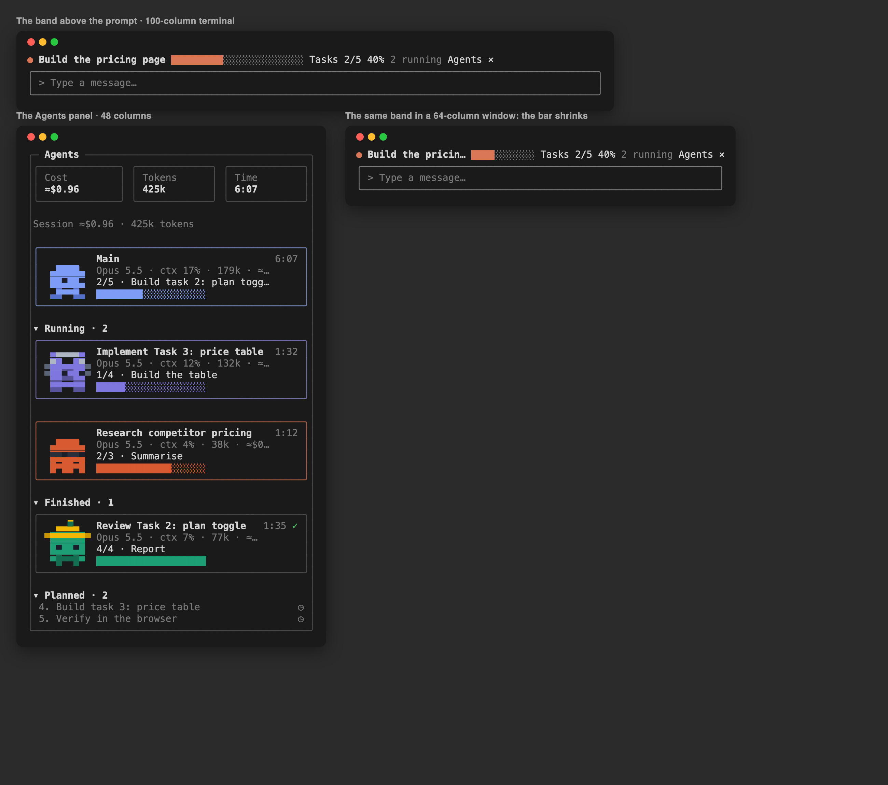

# Crew

A Claude Code mod that lets you watch your agents work. It adds a progress band above the prompt and an **Agents** panel listing Main and every sub-agent: what each is doing, its model, tokens, estimated cost and progress, each drawn as a small pixel mascot.



## What it does

### The band above the prompt

```
● Build the pricing page ██████░░░░ Tasks 2/5 40% 2 running Agents ×
```

- Shows while a turn runs and has sub-agents or a task list.
- The label is the first line of your prompt.
- The count is `Tasks done/total` when Claude keeps a task list, otherwise `Agents finished/spawned`.
- **Agents** opens the panel. **×** hides the band until your next prompt.

### The Agents panel

- **Totals:** cost, tokens and time for this prompt, plus a running total for the session.
- **One card per agent:** Main first, then sub-agents grouped as Running, Waiting, Finished and Failed. Each card shows:
  - effort, model, context used, tokens and estimated cost;
  - elapsed time;
  - step progress (`2/4 · Run the tests`) with a bar.
- **Planned:** the steps of Main's plan that haven't started yet.
- **Speech bubbles:** a running agent's mascot says what it is doing (`Reading band.tsx`, `Running bun test`). When it finishes, the bubble shows a short success phrase for a few seconds.
- **Files pane:** the `▸ 4` chevron on a card opens a second pane with the files that agent read, edited and committed. Purple means read, orange edited, green committed. The pane shows what it is touching right now, and the branch with its line counts.

Costs are estimates from a price table in [`hooks/pricing.ts`](hooks/pricing.ts) (dated in `PRICES_AS_OF`), so they carry a `≈`.

### Sub-agent steps

Crew asks every sub-agent to keep a short task list, so its card can show progress. A sub-agent with no task-list tool reports its steps through Crew's own `mcp__crew__set_steps` tool. A sub-agent that finishes cleanly shows every step done.

### Mascots

Each role (developer, designer, researcher, reviewer, plain) has its own look. Ask Claude to restyle one, for example "make the designer wear a hard hat" or "make reviewers green". It calls `mcp__crew__set_mascot`, and the change is kept across sessions.

Accessories: `headset`, `beret`, `glasses`, `hardhat`, `none`. Colours are `#RRGGBB`.

### The `crew-build` skill

Crew ships a skill that takes a feature from idea to a finished branch while the panel shows the work. It runs the [superpowers](https://github.com/obra/superpowers) flow in order: brainstorming, writing-plans, using-git-worktrees, then subagent-driven-development with reviewed sub-agents. It also verifies browser-visible changes in your real default browser.

Start it by asking Claude to "crew build" something, or to build a feature end to end. It expects the superpowers plugin to be installed. The `ponytail` skill and the personal `i-have-adhd` skill are used when present.

## Requirements

- Claude Code with mods: the terminal from 2.1.287, or the Desktop Code tab from 2.1.286.
- Mods don't run in `claude -p`, cloud sessions or WSL desktop sessions.

## Install

In a Claude Code session:

```
/plugin install crew --marketplace gjvpaet/crew
```

Or from your shell:

```bash
claude plugin install crew --marketplace gjvpaet/crew
```

Then run `/reload-plugins`, or start a new session.

### From a local clone

To work on Crew, clone it and start Claude Code with the folder:

```bash
git clone https://github.com/gjvpaet/crew.git
```

```bash
claude --plugin-dir /path/to/crew
```

To load it in every session, add the folder to `CLAUDE_CODE_PLUGIN_DIRS` instead. After changing files, run `/reload-plugins` to pick them up.

## Use

- The first time a sub-agent starts in a session, the panel opens on its own where it fits as a sidebar. Elsewhere, a toast tells you how to open it.
- `/crew` opens the Agents panel at any time.
- Claude can open it too, with `mcp__crew__open_panel`. The `crew-build` skill does this when a run starts.

The panel docks beside the transcript when the window is wide enough, and sits above the prompt otherwise.

## Develop

| Path | What's there |
| --- | --- |
| `hooks/register.tsx` | Entry point: event hooks, tools, the `/crew` command |
| `hooks/tracker.ts` | The state reducer: agents, turns, steps, files |
| `hooks/view.ts` | Turns state into what the band and panel show |
| `hooks/band.tsx`, `hooks/panel.tsx`, `hooks/files-pane.tsx` | The band, Agents panel and Files pane |
| `hooks/svg.ts`, `hooks/sprite.ts` | The SVG drawings on Desktop and the mascot sprites |
| `skills/crew-build/SKILL.md` | The `crew-build` skill |
| `test/` | Tests, one file per module |
| `docs/` | Design specs and implementation plans |

Run one test file (the script copies the mod to a scratch folder and runs only the files named):

```bash
sh scripts/test-one.sh view.test.ts
```

Validate the plugin:

```bash
claude plugin validate .
```
